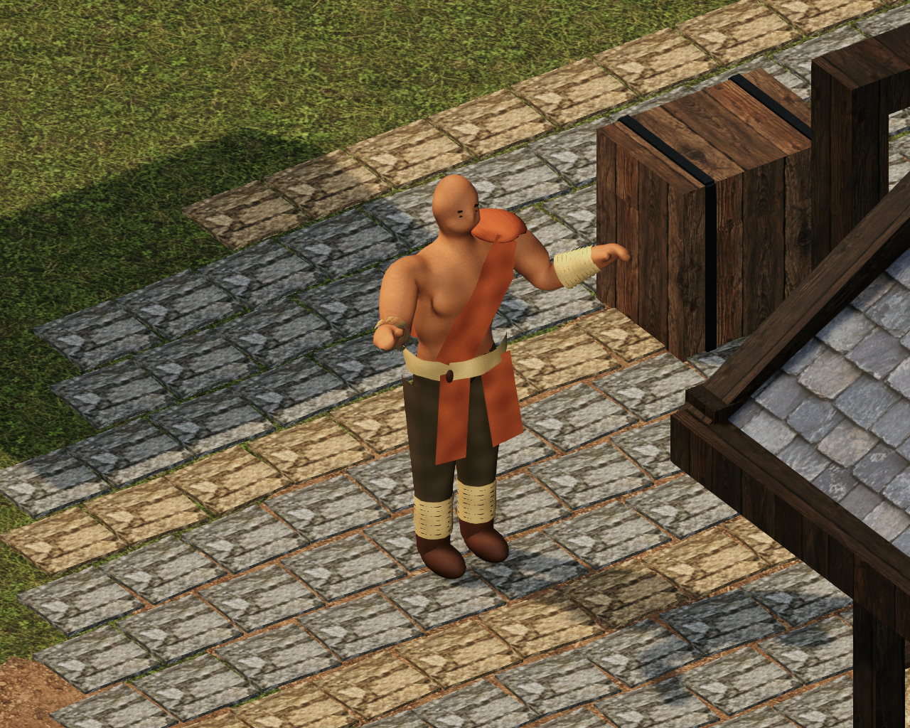
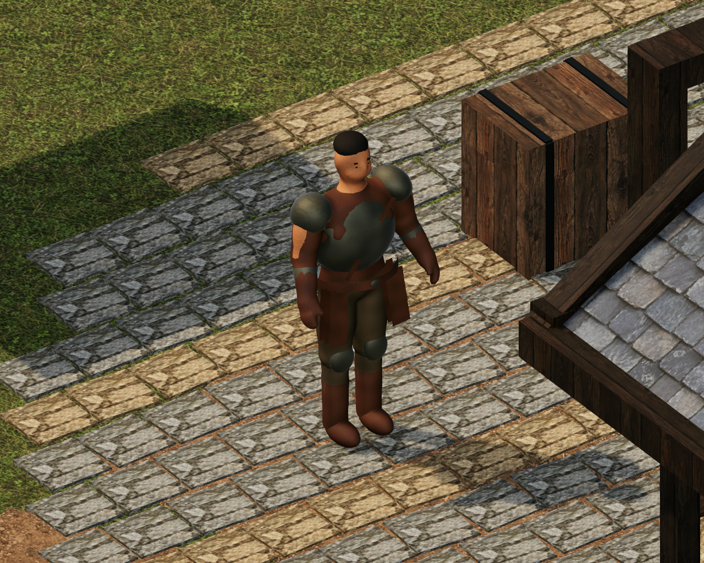
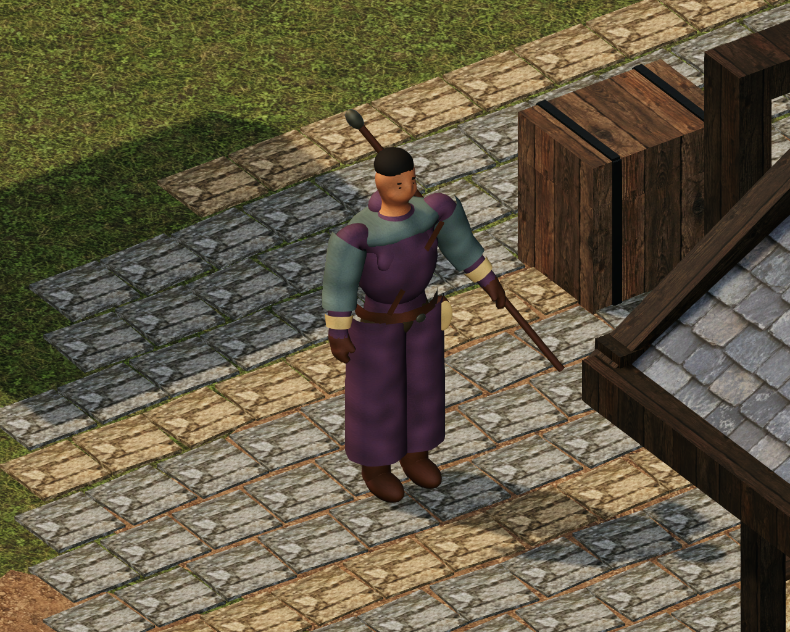

# E08 — Personajes articulados y animación

Inicio 2026-10-31; revisión 2026-11-01. Base 8f0108b/E07; PR #1 y #2 abiertos, borrador y sin fusionar. Rama feature/e08-personajes-animados; PR apilado hacia E07 mientras #2 esté pendiente. main/dev y PR anteriores no se fusionan.

## Auditoría y plan autorizado

Revisados AGENTS/checklist, GDD v0.2 §§12.1/12.2 y hojas originales Monje v02, Guerrero v01, Mago v01. Word intacto por SHA-256 dba82b1c18eb51bd36ee353cd3380af108aea41fe7ec539da644f08ea76bb661. Unity 6000.5.8f1 / URP 17.5.0. No ejecutable Blender, registro de instalación, carpetas usuales, módulo bpy o herramienta de modelado/Unity conectada encontrados. Assets solo contiene el grafo E02 vacío, perfiles sin clips y proxies estáticos, sin FBX/GLB/Blend o animaciones reales. No se instala software ni descarga assets.

Unity nativo permite autoría original de Mesh/SkinnedMeshRenderer, pesos/bindposes, Avatar Generic, AnimationClip y Animator. Se probará un piloto y su deformación antes de integrar las tres clases. Rig Generic elegido para clips nativos de transformaciones y estructura compartida; no se afirma retargeting Humanoid o un FBX profesional inexistente. El trabajo es base original provisional, no arte final aprobado.

Secuencia: E08-01 auditoría/capacidad y piloto; E08-02 mallas anatómicas, ropa/rig/skin y clips originales; E08-03 perfiles/controladores/equipo/locomoción y eventos de combate sin alterar reglas; E08-04 escena E07, pruebas/deformación/capturas/animación; E08-05 regresión/build/probes/paquete; E08-06 documentación/commits/PR. Modelo, animación, locomoción, combate, presentación y guardado conservan responsabilidades separadas. Se amplían contratos E02 con opt-in Generic; sus valores por defecto siguen exigiendo Humanoid.

No sprint nuevo, root motion, cambios de estadísticas/IDs/esquema v1 ni daño desde clips. El bastón del Mago sigue accesorio de identidad sin item nuevo; espada visible solo cuando el inventario la equipa. Las acciones visuales representarán comandos aceptados y resultados reales. La aldea y sus colisiones permanecen. F2-07 humano 7/8 informado, X/ESC pendiente; E08 y arte sujetos a revisión. No iniciar E09.

## Resultados

Base técnica implementada y verificada, pendiente de revisión humana/artística y publicación del PR de esta rama. Tres humanoides provisionales con skin y rigs Generic, siete estados por clase, locomoción y combate visual conectados a resultados reales. **Regresión final 73/73, salida 0; Windows y dos recorridos del ejecutable PASS.**

Se entregan 49 PNG reales y tres MP4 de muestras de clips; las tomas de inspección se distinguen de la ejecución integrada. ZIP local `ProyectoRPGRTS/Builds/Aethernia-E08-Personajes-Windows.zip` (86.334.027 bytes, 305 archivos; CRC y hash de todos los binarios comprobados). Diez ZIP anteriores conservados. El arte final realista, retargeting Humanoid, FBX/Blend y aprobación humana siguen pendientes. No se inicia E09.

## Recursos y fichas provisionales

Autoría original nativa en `Assets/03_Scripts/Editor/Characters/E08/`: NativeCharacterSkin (anatomía continua por campo implícito, ropa y pesos), NativeCharacterClips (poses y curvas), AnimatedCharacterBuilder (assets/integración). No contenido comprado, descargado o extraído de terceros. Se reutilizan los nueve materiales originales del proyecto y la espada de entrenamiento, sin duplicarlos; referencias visuales autorizadas de Documentacion/Personajes/Conceptos. La entrega no concede derechos sobre D&D ni copia personajes o interfaces.

- **Monje:** adulto rapado, proporciones atléticas; pecho parcialmente libre, tela diagonal naranja quemado, faja clara, pantalón oscuro amplio, vendas segmentadas en antebrazos/pantorrillas, calzado ligero y amuleto discreto. Guardia de manos altas y extensión del brazo derecho. Sin arma obligatoria ni habilidades nuevas.
- **Guerrero:** adulto robusto, pelo corto/barba; cuero marrón, coraza/pauldrons/brazales/rodilleras de acero sobrio, faldón corto y botas. Guardia armada y barrido de hombro/codo/torso. Espada solo si el item existente está equipado; desarmado conserva la acción y reglas actuales.
- **Mago:** adulto más delgado, pelo/barba sobrios; cuerpo vertical con ropa ciruela, sobrecapa azul grisácea, túnica dividida que sigue las piernas, cinturón y grimorio/bolsa. Anticipación y liberación con mano derecha en un único Attack de 1,3 s; bastón a la izquierda como accesorio sin item ni estadísticas. Sin proyectil/daño/alcance nuevo.

Escala raíz unitaria, 1 u = 1 m. Altura geométrica aproximada 1,80 m en las tres clases para compartir rig y clips, manteniendo las diferencias de volumen. La referencia histórica Monje 1,78 m no se borra. Hombros/cintura y ropa varían por clase, cápsula/agent conservados 0,6 m de diámetro × 1,8 m; arma existente 0,96 m, bastón 1,56 m. Medidas exactas finales y proporciones artísticas pendientes de revisión.

## Contrato de rig y sustitución

24 transformaciones: Root, Hips, Spine, Chest, Neck, Head; dos cadenas Shoulder/UpperArm/Forearm/Hand/Fingers y UpperLeg/LowerLeg/Foot/Toes. Una malla skinned corporal/ropa por clase, dos influencias normalizadas por vértice, 24 bindposes, juntas compartidas. Root y hombros son auxiliares jerárquicos; no todos requieren influencia directa. Dedos agrupados, sin expresiones faciales ni IK. Skinning real no equivale a un acabado anatómico o texturizado final.

Avatar **Generic válido, no Humanoid**. Opt-in `HumanoidVisualRig.allowGeneric` y `HumanoidAnimationProfile.AllowGenericClips`; E02 sigue estricto por defecto. `ModelRoot` es raíz del Animator y contiene Root; clips en espacio local, sin root motion, eventos ni efectos de juego. Un controller compartido y dos AnimatorOverrideController para Guerrero/Mago; Walk/Run/Hit/Defeat compartidos, Idle/Attack/Defend específicos. Velocidad de locomoción observada del agente y cadencia proporcional; Run a partir de 2,8 m/s de velocidad existente, no un nuevo sprint.

Para sustituir por arte final: conservar controlador/cápsula/agente, colocar el nuevo modelo a escala 1 en una copia del prefab, preparar huesos y pesos en metros/T-pose, triangulación y UV sin estiramientos, importar FBX con transformaciones aplicadas y materiales URP compartidos. Preferir Humanoid válido para retargeting externo y usar el pipeline E02; sus clips han de ser Humanoid. Si se conserva Generic, mantener rutas exactas o adaptar clips en una copia y activar opt-in explícito. Verificar bindposes, codos/hombros/caderas/rodillas, límites/ropa, suelas, WeaponSocket y Root inmóvil. Nunca marcar Human válido a un Generic. Reemplazar `HumanoidPrefab` del catálogo E08 y sus perfiles, probar con la misión/guardado y conservar el proxy `Prefab` para fallo seguro. No se entrega un FBX/Blend ni retargeting humano certificado; la fuente editable es C# más Mesh/Avatar/AnimationClip nativos.

## Primer control incremental

Autoría/compilación Unity exacto: salida 0. Primeras pruebas: 5/6, un fallo de Idle al llegar por velocidad residual del NavMeshAgent. Capturas iniciales mostraron tela parcialmente enterrada, vendas estrechas y una valla delante del encuadre. Se corrigen ajustando prendas sobre la superficie original y pesos, seleccionando Idle cuando el agente completa el trayecto, y trasladando únicamente la posición de captura de prueba. Los GUID/escenario y reglas se conservan. Resultados finales pendientes de la repetición.

## Revisar en Unity

1. Abrir ProyectoRPGRTS con Unity 6000.5.8f1; cargar `Assets/01_Scenes/AetherniaVillageDemo.unity`, esperar importación/Console y pulsar Play. No ejecutar otra vez los generadores. `PlayablePrototype` mantiene el aspecto anterior.
2. En Personaje elegir Monje, Guerrero o Mago fuera de combate; cerrar con ×/ESC (validación humana de cierre aún pendiente). Seleccionar héroe y ordenar un recorrido largo con clic derecho: la velocidad existente activa Walk/Run y vuelve a Idle al completar el trayecto. No se añadió control de sprint.
3. Acercarse al cofre, recoger/equipar espada y túnica desde Inventario. Verificar que la espada siga la mano derecha; el Mago conserva el bastón de identidad en la izquierda. Modelo y acciones nunca fabrican un item, daño o defensa.
4. Menú → combate RPG o misión «El cargamento perdido»; acercarse si está fuera de alcance, Atacar y Finalizar turno. Un fallo de tirada sigue siendo un golpe intentado; un comando rechazado por alcance/acción no reproduce otro golpe. Probar Defender, recibir daño y la derrota; elegir clase al volver a Explorar recupera salud conforme al prototipo previo.
5. Repetir la misión con las tres clases, guardar F5 y cargar F9, probar construcción/RTS y observar cámara/selección. No usar archivos de prueba Logs como partidas personales.
6. Para inspección técnica abrir los prefabs `Assets/02_Prefabs/Characters/E08/{monk,warrior,mage}_Animated.prefab`. Ver ModelRoot/Root, SkinnedMeshRenderer/pesos y Animator. Los perfiles y clips están en `Assets/07_Characters/AnimatedE08/Animation`; el grafo compartido y overrides son editables. El catálogo E08 permite restaurar proxies sin eliminar ningún asset.

Prueba automática focal: `./Tools/Invoke-UnityValidation.ps1 -Mode Vertical -TestFilter Aethernia.Tests.Editor.AnimatedCharacterTests`. Regresión: modo Vertical sin filtro y -TimeoutMinutes 15. Build de aldea: modo BuildVillage. Player: `./Tools/Invoke-PrototypeSmoke.ps1 -RequireCargo -RequireVillageE07 -RequireAnimatedE08`, después repetir con `-WithGraphics`. Cerrar el editor de este proyecto antes de lanzar estos comandos.

Las tomas View/Pose/AVI son renders nativos de poses del rig muestreadas uniformemente, con una luz temporal de inspección, sin editar el escenario guardado. Los archivos Actual-* y las capturas del player corresponden a ejecución integrada con la iluminación normal. Un AVI de muestras no se presenta como una partida grabada o una medición de FPS.

## Pendientes explícitos

Aprobación humana/artística de las tres siluetas, lectura en cámara, suavidad y comportamiento de ropa en todos los ángulos; modelado/texturizado final, expresiones faciales/dedos individuales, animación profesional e IK/retargeting Humanoid. No hay FBX/Blend exportado. Revisar pesos/ropa con artista antes de producción; los casos automatizados prueban posiciones/pesos/estados, no certifican anatomía ni estética. Cierre humano X/ESC y E07 continúan pendientes. No se inicia E09.

### Correcciones verificadas durante el diagnóstico

La transición a derrota señalada inicialmente no era un fallo confirmado de juego: el registro de tiempo mostró que el runner EditMode no respetaba `WaitForSeconds` en ese ensayo; se sustituyó por una espera explícita con frames/tiempo efectivo. Las exigencias de estado y resultados no se rebajaron; los seis casos focales pasaron después. La actualización de mallas con CopySerialized conservó parte de los buffers de vértices anteriores en este editor; se cambió a setters explícitos de Mesh, conservando GUID, y se añadió una comprobación de que las vendas guardadas rodean la piel. Algunas caras de unión del campo implícito requerían corregir winding respecto de sus normales; se orientan de forma coherente y se comprueban en assets. Estas observaciones son de autoría/validación, sin cambios en reglas.

## Cobertura del encargo y alcance final

E08-A corresponde a E08-01 del checklist; B/C/D a E08-02; E/F/G/H/J a E08-03; I/K/L a E08-04; M a E08-05; N/O a E08-06. La revisión humana tiene una tarea independiente. No hay un esqueleto meramente decorativo ni una simulación moviendo el objeto entero: los clips contienen curvas de 24 huesos y las posiciones de vértices cambian al hacer BakeMesh. Los proxies E03, el candidato E02 y PlayablePrototype no se sustituyen.

| Clase | Vértices de malla principal | Triángulos | Huesos | Avatar |
|---|---:|---:|---:|---|
| Monje | 26.676 | 51.636 | 24 | Generic válido |
| Guerrero | 28.295 | 56.320 | 24 | Generic válido |
| Mago | 28.252 | 54.968 | 24 | Generic válido |

Cifras de la malla principal con ropa; espada, parche de equipo y bastón tienen geometría adicional compartida/nativa. Solo un héroe activo. Sin nuevos materiales/texturas, nueve referencias compartidas, trece clips y un grafo con dos overrides. No se afirma objetivo de FPS, presupuesto comercial o retargeting; medir antes de LOD/optimización compleja. Anatomía/rostro/UV son de piloto y requieren trabajo de artista para acabado realista final.

La victoria que devuelve automáticamente a explorar conserva el último golpe pendiente y elimina la cola cosmética atrasada. Carga, nueva actividad, nuevo encuentro y cambio de modelo limpian acciones anteriores. Recompensa, daño, tiradas, salud, desplazamiento, navegación, modos y guardado v1 siguen bajo las reglas existentes; el cue de finalización no añade lógica de victoria.

Se localizó después un FFmpeg 7.1 ya incluido en imageio_ffmpeg (no estaba en PATH), junto con OpenCV/Pillow instalados. Se usan para empaquetar y decodificar muestras de Unity en MP4 H264 sin instalar ni descargar software. Cada clip de demostración contiene doce fotogramas reales muestreados; la tasa de reproducción 13/9 fps no mide el rendimiento del juego. Los AVI intermedios permanecen en Logs, fuera de Git.

## Galería para revisión

Estas tres vistas usan la luz temporal de inspección y el escenario E07 intacto. Son modelos del piloto, no ilustraciones ni acabado realista final.

Animación articular muestreada en Unity: [Monje](Images/E08/monk-Attack-Sampled.mp4), [Guerrero](Images/E08/warrior-Attack-Sampled.mp4), [Mago](Images/E08/mage-Attack-Sampled.mp4). Son muestras uniformes del clip, no grabaciones de una partida. Las tomas `Actual-*-Attack/Hit/Defend/Defeat.png` documentan comandos y resultados durante Play Mode, sin luz añadida; `Player-*` corresponde a la build. Índice/hash de cada archivo en Validacion/E08_EVIDENCIA.json.

## Incidencia de validación del guardado

La segunda pasada completa devolvió 72/73 por un fallo de Save tras escribir su temporal, en el recorrido histórico de mazmorra; no se ocultó ni relajó la prueba. El temporal válido se conservó para diagnóstico. Una repetición focal del mismo recorrido aprobó junto a las capturas (2/2); un sondeo nativo de 200 reemplazos pasó. No se confirma antivirus, permisos o un bloqueo concreto sin evidencia. Se añadió LastWriteFailure (tipo/HResult/mensaje) a la observabilidad del escritor, sin cambiar su operación atómica, validación o esquema, y una explicación del error en la aserción. Se repite la suite y se comprobará también el guardado en el ejecutable. XML de la pasada intermedia/recontrol conservados; no se presenta esa pasada como 73/73.

## Resultado final de validación

- Regresión final: **73/73**, cero fallos/omisiones y salida 0 del editor/lanzador, incluyendo los seis casos E08 y los 67 previos. XML `Validacion/E08_REGRESION.xml`. El recontrol focal anterior conserva 2/2 en E08_RECONTROL.xml; la incidencia intermedia de guardado se conserva en E08_REGRESION_INTERMEDIA.xml y no se oculta.
- Build Windows x64 de desarrollo: **Succeeded**, 203.270.570 bytes y 73,08 s de fase de build reportada por Unity; no es tiempo de arranque ni medida de FPS.
- Ejecutable sin gráficos: **PASS, 54,77 s**. Ejecutable con GPU: **PASS, 55,46 s**. En cada recorrido se verifican navegación, cofre/equipo, comercio, taller, mazmorra/reputación, guardado/carga, combate RPG, escalada RTS/6 contra 6 y misión real de las tres clases. E08 añade comprobación de rig/Idle/Walk/Run/ataque aceptado y rechazado/guardia/daño/derrota/guardado de las tres clases. Capturas del player inspeccionadas.
- Evidencia seleccionada: **49 PNG** (33 inspecciones de poses/ángulos, doce acciones/resultados durante Play Mode y cuatro del player) y **tres MP4**, cada uno con doce fotogramas del rig, decodificados completos. El material es nativo de Unity; no se usan conceptos 2D para sustituir capturas. Hash e índice: Validacion/E08_EVIDENCIA.json.
- Paquete: SHA-256 **adbb3fe1c1fa701f62dbaaf5d165aae532ce47e598d5b3874ecf4fb2b781591b**. Validación CRC y contenido frente a los 305 archivos originales: PASS. Nombres/tamaños/SHA de diez ZIP previos coinciden. Comprobante Validacion/E08_PAQUETE.json. ZIP local excluido de Git, sin release pública o versión estable nueva.
- GDD original, escena PlayablePrototype, paquetes y versión de motor conservados. La demo E07 recibe únicamente catálogo/componente de presentación E08. Matriz de resultados, rigging, integración y recibos del player: **Validacion/E08_RESULTADOS.json**.
- Comprobaciones automáticas y revisión técnica de imágenes realizadas; **no hubo sesión manual humana en Unity**, aprobación artística, validación de diversión/balance o cierre F2-07/X/ESC. El incidente aislado de escritura no reapareció en el recontrol, regresión final ni ambos players; su causa concreta sigue sin confirmarse y el escritor conserva diagnóstico sin cambiar esquema/reglas.

Para ejecutar: descomprimir el ZIP completo y abrir Aethernia.exe. Para evaluación desde GitHub: seleccionar la rama feature/e08-personajes-animados, clonar/actualizar y abrir ProyectoRPGRTS con Unity 6000.5.8f1; los binarios locales no están en Git. No fusionar main/dev ni PR anteriores como parte de esta revisión. Siguiente actividad recomendada: sesión humana del piloto y revisión de modelos/ropa/animaciones con artista antes de avanzar a producción final o retargeting; E09 no se inicia automáticamente.

## Versionado

Base E07 `8f0108b`; cambios de implementación `6242116`, refinamiento/golpe final `53ee6ea`; bloque de verificación y documentación completado en los commits siguientes de feature/e08-personajes-animados. PR de revisión: publicación en curso. main/dev y PR #1/#2 se conservan sin fusionar.
