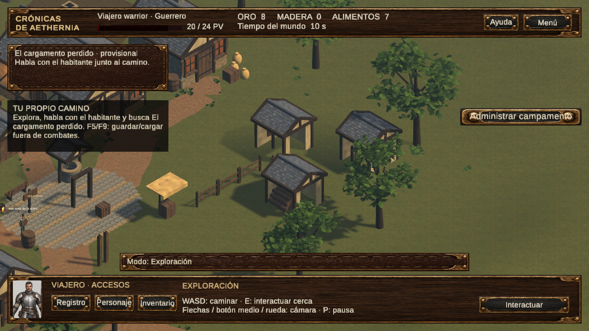
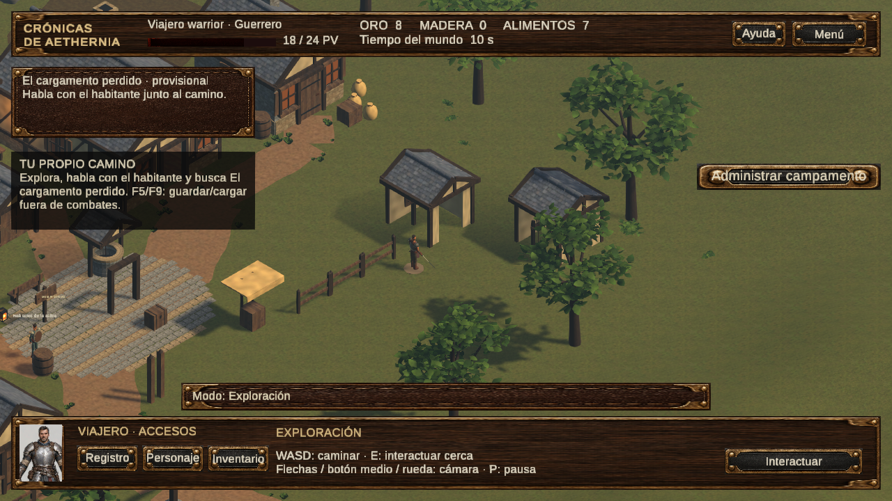

# Primera demo integrada E10–E13

Estado técnico: **110/110 pruebas de regresión aprobadas**, sin omisiones; después del último ajuste visual, **6/6 pruebas de asentamiento aprobadas**. Compilación Unity6000.5.8f1/URP17.5.0 correcta. Doce procesos Windows finales y dos desde ZIP extraído aprobados. [PR#5 publicado en borrador](https://github.com/MathiasMerino/RPGRTS/pull/5), apilado sobre E09. La evaluación humana permanece pendiente.

## Fases y alcance

| Fase | Resultado técnico | Pendiente |
|---|---|---|
| E10 | Menú real, SDF compartida, créditos y opciones persistentes | Evaluación humana de apariencia, sonido y pantalla completa |
| E11 | Nombre/clase/linaje, prólogo/omisión, tutorial RPG, WASD/animación/cámara | Balance, narrativa y apariencias raciales finales |
| E12 | Patrulla6v6 con mismo héroe/HP/equipo, selección, grupos, órdenes y acciones | Animaciones militares finales y valoración humana |
| E13 | Cinco edificios, costes, activación, producción, mejoras, reclutas y guardado | Arte de edificios definitivo e interiores |
| E14 | No iniciada; compañeros y mazmorra ampliada | Siguiente iteración tras evaluar la demo |
| E15 | No iniciada; territorio/conquista | Dependiente de núcleo validado y desarrollo posterior |

El recorrido va de menú a creación, prólogo, combate RPG, exploración WASD, capitán, patrulla RTS, campamento y juego libre. No fuerza una coronación. Guerrero/Monje/Mago conservan reglas y perfiles existentes. Humano/elfo/enano son metadatos sin bonos ni modelos raciales nuevos; el aviso aparece en creación. Prólogo y economía nueva son provisionales, no canon añadido al GDD.

## Integración y archivos

Escena nueva **Assets/01_Scenes/AetherniaFirstDemo.unity**. AetherniaVillageDemo, PlayablePrototype y demás escenas históricas se conservan. No cambiaron Packages, versiones del motor/URP ni GDD Word; hash y revisión de fuentes en [auditoría](../../Validacion/DemoE10E13/auditoria-fuentes.json).

- Assets/03_Scripts/Runtime/Demo: presentación, progreso, preferencias, control directo, orientación y paneles RTS/asentamiento.
- Assets/10_Demo: contenido externo, SDF, reglas y prefabs de interfaz/cinco edificios. Materiales, shell de arquitectura y props E07 reutilizados; ninguna descarga de procedencia desconocida.
- PrototypeState/GameSession/PrototypeDirector, TurnEncounter, RtsBattleController, WorldConstruction, inventario, facciones y economía originales siguen compartiendo una partida.
- HeroActionRules mantiene reglas comunes; la presentación Generic y el equipo se reutilizan sin root motion. El héroe RTS es el mismo objeto/modelo y escribe en la misma salud.
- AtomicFileReplacement separa política de escritura del estado. Los probes de captura/DSP/recorrido solo se crean con argumentos explícitos de validación.

Una unidad representa un metro. Los cinco edificios usan huella3×3m, altura aproximada3.2m y vano visual1.5×2.2m; la huella completa es sólida, sin interiores transitables. Personaje/controlador1.8m y medidas previas conservadas. El recorte reutiliza RoofCutaway y afecta contextualmente el conjunto visual del edificio (tejas, hastiales y vigas); los colliders y NavMeshObstacle permanecen activos y con los mismos bounds.

## Correcciones verificadas

1. JsonUtility fabricaba un progreso inicial al serializar Demo nulo. HasDemoProgress distingue explícitamente campaña y guardado legado; Version1 se mantiene y las cargas antiguas vuelven a funcionar.
2. Error Windows1175 al reemplazar JSON antiguo. Se conserva File.Replace atómico con hasta4reintentos50/100/200/400ms para32/33/1175; no se borra el destino ni se reintentan permisos permanentes. Bloqueo real200ms, recuperación y conservación al agotar intentos probados.
3. Slider dibujaba relleno/tirador fuera de su rectángulo. Anclajes corregidos, aceptación geométrica y raycasts a cuatro resoluciones. Pausa oculta HUD y lo restituye al reanudar.
4. Referencia Audio perdida al guardar el prefab de menú. Override de escena enlaza el reproductor E09 compartido; efectos, volumen, cámara, calidad y resolución se verifican también entre procesos.
5. Un techo del nuevo campamento ocultaba al héroe. Recorte existente conectado a las mallas reales Slate (el nodo Roof es una referencia vacía); ocultación/restauración y física intacta comprobadas. La valoración visual humana sigue pendiente.

No se alteraron vida o victorias para conseguir resultados favorables. Los recorridos usan dados controlados42 para reproducibilidad y acciones legales; el juego normal conserva su inicialización habitual. La prueba de derrota cede turnos hasta0PV y usa el botón de reintento explícito.

## Pruebas y evidencia

| Comprobación | Resultado |
|---|---|
| Regresión de sistemas antiguos y nuevos | [110/110 PASS](../../Validacion/DEMO_REGRESION_110.xml) |
| Tras recorte final: economía/guardado/reclutas/despliegue/visibilidad y física | [6/6 PASS](../../Validacion/DEMO_RECORTES_FINAL.xml) |
| Bloqueo real de archivo y derrota/reintento | [2/2 PASS](../../Validacion/DEMO_BLOQUEO_DERROTA.xml) |
| Colisión WASD y opciones720p–4K | [PASS](../../Validacion/DEMO_COLISION_OPCIONES.xml); ampliadas en regresión |
| Windows tres clases, crear y nuevo proceso Continuar, sin gráficos/conGPU | 12/12 procesos PASS; estado/recursos/edificios/ejército y opciones persistentes |
| ZIP portable, CRC y SHA por archivo;12ZIP previos intactos | 306 archivos, CRC y SHA individual PASS; dos procesos desde ZIP extraído PASS |

Primeras baterías102(91PASS/11FAIL) y103(101PASS/2FAIL), incidentes de opciones y preparación de pruebas se conservan en los XML/intermedios y en [registro técnico](DEMO_E10_E13.md). No se presentan como pruebas aprobadas. La regresión110 es anterior únicamente al recorte final, cuya aceptación ampliada6/6 se ejecutó después; no se suman resultados superpuestos como si fueran casos distintos.

18 capturas PNG (incluida comparativa antes/después) son copias exactas de Unity/Windows. El agente inspeccionó las imágenes; no hubo una sesión manual nueva del usuario. El vídeo contiene407fotogramas codificados,33.917s/1280×720; fuente408fotogramas/audioDSP RMS0.002746, final recortado un fotograma por sincronía de audio. [Manifiesto y procedencia](../../Images/DemoE10E13/capturas.json), [vídeo nativo](../../Images/DemoE10E13/Aethernia-Demo-E10-E13.mp4) y [metadatos](../../Images/DemoE10E13/video.json). Grabación continua a paso fijo12Hz con audio AudioRenderer DSP; esa tasa no mide FPS. Sin composición de imágenes o poses simuladas. Windows usó RTX3050Laptop; los picos de memoria en los recibos son muestras de working set, no un perfilado de FPS/GC ni un benchmark comparativo. No se aplicaron optimizaciones complejas.

## Probar la demo

Descomprimir completo **ProyectoRPGRTS/Builds/Aethernia-E10-E13-Demo-Windows.zip** y abrir Aethernia.exe. Mantener Aethernia_Data y demás archivos juntos. La build es Windows x64 de desarrollo; no se publica como versión comercial. Paquete87.411.924bytes; SHA-256 `6c833b8dab2bac55cc67502ee9f607eaecaea3494fd2837e4776b0673b81026e`. Los12ZIP históricos permanecen intactos.

En Unity: abrir ProyectoRPGRTS con6000.5.8f1, cargar AetherniaFirstDemo.unity, esperar importación y pulsar Play. No ejecutar generadores de autoría para arrancar. Cerrar ese editor antes de usar:

```powershell
.\Tools\Invoke-UnityValidation.ps1 -Mode Vertical -TimeoutMinutes 25
.\Tools\Invoke-UnityValidation.ps1 -Mode BuildFirstDemo -TimeoutMinutes 25
.\Tools\Invoke-DemoSmoke.ps1
.\Tools\Invoke-DemoSmoke.ps1 -WithGraphics -Record
```

Nueva partida → clase/linaje/nombre → continuar u omitir prólogo. En RPG acercarse si falta alcance, actuar y finalizar turno; esperar la fase enemiga. Tras vencer: WASD camina, clic derecho conserva navegación, flechas/botón central desplazan cámara y rueda ajusta zoom. E interactúa cerca. Capitán al norte(-12,0,8). Usar ración si hace falta; los recursos son reales.

RTS: clic/arrastre/Shift, Ctrl+1..3 memoriza grupos y1..3 recupera; clic derecho mueve o ataca; acciones del héroe en panel. Campamento: administrar, elegir y colocar centro(12,0,-8), taller(8,0,-13), activar y esperar producción; cuartel(15,0,-13), reclutar. Recorrido inicial funciona con50oro/20madera/10alimento, sin fixture económica. P abre pausa/opciones; Aplicar y volver reanuda. F5/F9 o Menú guardan/cargan fuera del combate; Guardar y volver al título permite salir y Continuar después.

Slot nuevo: `%USERPROFILE%/AppData/LocalLow/DefaultCompany/ProyectoRPGRTS/AetherniaPrototype/demo-v1.json`. Slot save-v1.json legado preservado. Nueva partida respalda el slot de demo antes de reemplazarlo. Opciones se guardan aparte; QA usa claves/slots aislados y no la partida personal. Producción solo en tiempo jugado, pausada en menús/combates; no hay producción desconectado.

## Límites, Git y siguiente paso

[Guía humana](../Validaciones/PRUEBA_MANUAL_DEMO.md) enteramente pendiente. También continúan E09-H/E08-H/E07-H/F2-07 y confirmación X/ESC. Arte/Generic/clips/audio son provisionales, linajes visuales no implementados, pantalla completa y percepción de balance/legibilidad requieren revisión humana. Interiores de edificios, música, compañeros, mazmorra ampliada y conquista no forman parte del núcleo cerrado.

Rama feature/e10-e13-demo-jugable sobre E09 para conservar la pila de PR. Commits por fase1ee7ae2,22e627d,00ed6c1,dd56e9c y correcciones91d83b7; pulido/evidencia238d9e2 y cierre documental posterior conservados. [PR#5](https://github.com/MathiasMerino/RPGRTS/pull/5) abierto en borrador sobre feature/e09-combate-rpg-ia. Main/dev y PR#1–#4 verificados intactos, sin merge ni force push. El FBX MonkMeshy ajeno se conserva sin seguimiento fuera de nuestros commits; no se integra ni se publica.

Siguiente actividad recomendada: sesión DEMO-H, registrar claridad/dificultad/controles/visibilidad y corregir hallazgos. Después E14 (compañeros/mazmorra) y E15 (territorios), cada una con aceptación propia; no iniciar una expansión masiva automáticamente.


### Comparativa del campamento

Antes, el conjunto de cubierta/hastial ocultaba al héroe. Después se retira contextualmente solo el conjunto visual del edificio que se interpone; la huella física sigue activa. Misma cámara35.264°/45°, zoom11 y foco(11,0,-10); la salud puede variar por el combate real entre ejecuciones.




