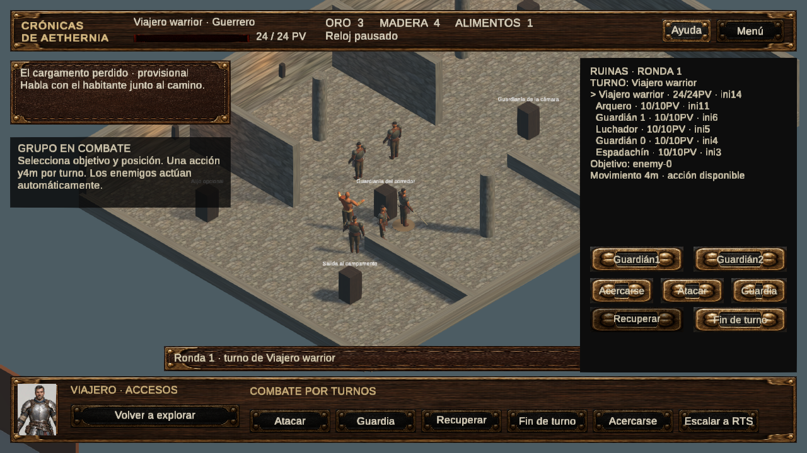
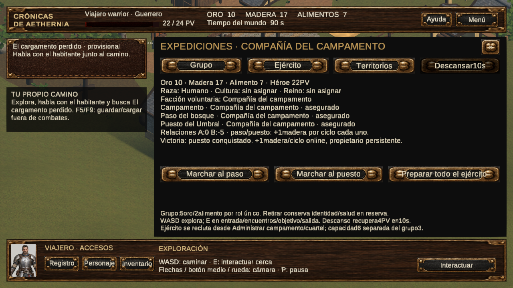

# Entrega E14–E15 — Crónicas de Aethernia

Estado: **E14 y E15 completadas técnicamente para el alcance piloto**. Evaluación humana, balance y arte definitivo pendientes. No se inició E16.

## Resultado del núcleo

E14 amplía el prototipo existente: tres roles de compañeros, reclutamiento pagado, grupo/reserva, seguimiento, mazmorra de dos encuentros, turnos individuales, recompensa única y recuperación en campamento. E15 comparte héroe, recursos, reputación y guardado; prepara soldados concretos, reclama un paso neutral y conquista un puesto mediante RTS real. El beneficio territorial llega a la producción E13.

La nueva escena es AetherniaExpeditions. Las escenas anteriores, GDD0.2, motor6000.5.8f1, URP17.5.0, clases, misión, inventario/equipo y prefabs previos se conservan. Reglas nuevas y arquitectura: [expediciones](E14_E15_EXPEDICIONES.md). Uso: [guía](../../GUIA_EXPEDICIONES.md).

## Pruebas realizadas

| Tipo | Evidencia | Resultado |
|---|---|---|
| Automática relacionada antes de ampliar | E14_BASE_RELACIONADA_23.xml |23/23 PASS|
| Reglas nuevas | E14_GRUPO_INTERMEDIO.xml |8/8 puras PASS; primera integración falló, conservada|
| Play Mode grupo/mazmorra | E14_INTEGRACION.xml |1/1 PASS, dos combates reales y guardado|
| Composición reducida/derrota | E14E15/CAMPAIGN_FOCAL.xml |2/2 PASS: Mago con dos compañeros; RTS perdido sin conquista y recuperación|
| Windows sin GPU | E14E15/Headless |6 procesos PASS, tres clases y tres reinicios|
| Windows con GPU, antes del pulido de etiquetas | E14E15/GPU |6 procesos PASS, tres clases y tres reinicios|
| Regresión global | [REGRESION_121.xml](../../Validacion/E14E15/REGRESION_121.xml) |121/121 PASS; cubre los110 casos anteriores y11 nuevos|
| Tras pulido de presentación | [PULIDO_FOCAL_11.xml](../../Validacion/E14E15/PULIDO_FOCAL_11.xml) |11/11 PASS; sin modificar estadísticas|
| UI final en escena refinada | [UI_FINAL.xml](../../Validacion/E14E15/UI_FINAL.xml) |1/1 PASS:8 vistas, dos resoluciones, textos/bounds/raycast, ficha/ayuda y héroe sin HUD encima|
| Windows final con GPU | [FinalGPU](../../Validacion/E14E15/FinalGPU) |6 procesos PASS, tres clases y reinicio por clase|
| ZIP extraído | [PORTABLE.json](../../Validacion/E14E15/PORTABLE.json), [recibos](../../Validacion/E14E15/Portable) |CRC/SHA por archivo y2 procesos adicionales PASS|
| Manual humana | EXP-H |Pendiente; no ejecutada automáticamente|

**20 procesos Windows aprobados en total**:6sinGPU,6GPU previos al pulido,6GPU de revisión final y2desde ZIP extraído. Las suites se repiten con propósitos distintos; sus cantidades no se suman como pruebas únicas.

Los recorridos Windows parten de copias intactas de partidas E13 auténticas, con hashes versionados; no crean salud, dinero ni victorias. Pausan el taller para reservar alimento, recogen el cofre, pagan tres compañeros, descansan con tiempo de mundo, vencen ambos encuentros, cobran una vez, pagan granja/soldados y ganan la conquista. Un proceso nuevo compara el estado serializado y las instancias físicas. Fixtures de reglas/UI/derrota están identificadas y separadas de ese recorrido.

## Correcciones y límites

- Reproducido atasco de un compañero al intentar alcanzar un espacio ocupado. Seguimiento cede paso al héroe; la aproximación evita movimientos innecesarios, cancela si no progresa y permite terminar turno, conservando el presupuesto gastado. Dos guardianías y tres clases pasan después de corregirlo.
- Cámara vuelve a la región80 de ruinas tras combate/carga; las paredes frontales y dos divisiones próximas tienen recorte visual0.65m con colliders3m intactos. Suelo conserva material existente con UV cada2m.
- Patrulla y conquista distinguen ContextId. La conquista despliega exclusivamente soldados preparados; no obtiene seis aliados gratuitos ni recompensa de campamento otra vez.
- Descanso se cancela al cambiar de estado/partida. Compañeros fuera de combate conservan ID/HP; soldados caídos mantienen la regla E13.
- Ruinas/puesto y cifras son provisionales. El puesto usa un marcador y un encuentro en el área RTS ya validada, con regreso a su ubicación; no se construyó una fortaleza definitiva. La economía no produce offline y el ejército continúa limitado a6.
- Se observaron avisos internos JobTempAlloc en recorridos anteriores; resúmenes conservados, causa no atribuida. Los8procesos finales (6GPU+2portable) terminaron sin esos avisos, excepciones de scripts ni agentes inválidos. No se considera una corrección del motor ni un perfilado completo. No se inventan FPS/GC: el vídeo usa paso de captura12Hz; las métricas de proceso solo registran tiempo y memoria muestreada.
- Tres texturas E07 restauradas por autorización expresa. El FBX Meshy local permanece intacto y ajeno a los commits. No hubo plugins nuevos ni recursos comerciales descargados.

## Entrega y revisión

- Build local: `ProyectoRPGRTS/Builds/ExpeditionsWindows/Aethernia.exe`. ZIP nuevo: `ProyectoRPGRTS/Builds/Aethernia-E14-E15-Expediciones-Windows.zip` (87.5MB). Incluye guía, tres partidas E13 reales y lanzadores aislados. No necesita Meshy. Los13ZIP anteriores conservan sus hashes.
- SHA256 ZIP: `958df84773407fe81274c366588ba60e97b4fe19feca69763c37be38912baf36`. CRC, extracción y hashes individuales en PORTABLE.json. No se distribuye la carpeta DoNotShip.
- **22PNG del player Windows intactos +2PNG de fixtures Play Mode para resoluciones**, en [galería](../../Images/E14E15). [Manifiesto nativo](../../Validacion/E14E15/Media/manifest.json), [evidencia UI](../../Validacion/E14E15/UI_LAYOUT.json). No son imágenes conceptuales generadas.
- Vídeos con audioDSP: [expedición,23.8s](../../Videos/E14E15/E14-Expedicion.mp4) y [conquista,8.1s](../../Videos/E14E15/E15-Conquista.mp4). Cada uno recorta un tramo continuo de una ejecución; decodificación verificada y SHA/intervalos de fotogramas documentados. Grabación fuente1519frames,12Hz de captura, RMS0.003030; no es una medición de FPS.
- [Auditoría de fuentes](../../Validacion/E14E15/SOURCE_AUDIT.json): GDD, versiones/paquetes y escenas originales intactos. main/dev y PR1..5 siguen sin fusionarse ni modificarse; rama feature/e14-e15-expediciones-conquista desde c33e34d. [PR#6 publicado en borrador](https://github.com/MathiasMerino/RPGRTS/pull/6), apilado hacia feature/e10-e13-demo-jugable; [verificación GitHub](../../Validacion/E14E15/GITHUB.json). No se aprueba arte ni se fusiona automáticamente.

La siguiente actividad recomendada es una sesión humana de navegación, composición de grupo, dificultad y claridad de la conquista; corregir sus hallazgos y perfilar antes de ampliar contenido/territorios. Modelos, animaciones, iluminación profunda y shaders finales permanecen en una línea artística separada.

Todos los cambios de la entrega están confirmados en Git. Los únicos archivos locales sin versionar son los recursos Meshy ajenos, conservados fuera del PR; no se ocultan ni se eliminan.
