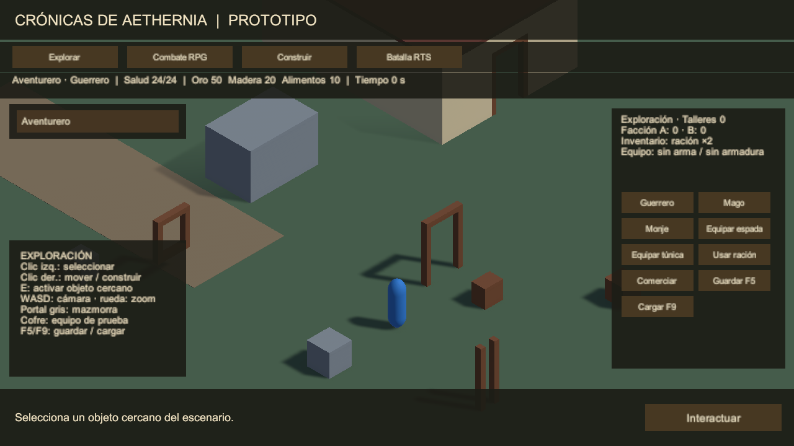
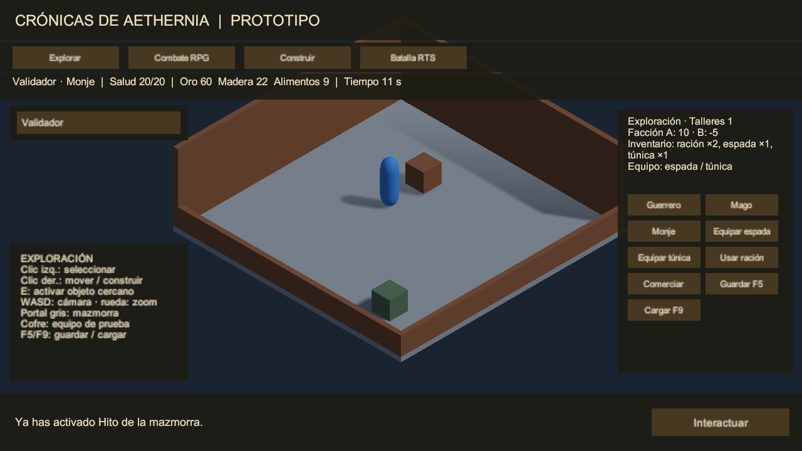

# Fase 2: auditoría, integración y experiencia jugable

Fecha: 2026-10-30, America/La_Paz. Alcance autorizado: auditar los doce sistemas existentes, corregir fallos pequeños reproducibles, verificar integración y entregar otra build. No se inicia expansión de contenido ni una transición compleja RPG/RTS.

## Estado de entrega

La validación técnica aprobó **34/34 pruebas, cero fallos/omisiones y salida 0**, con Unity 6000.5.8f1 y URP 17.5.0. La build corregida compiló y completó dos recorridos independientes, sin gráficos y con dispositivo GPU, ambos con salida 0 y sin el aviso de agente inválido ni excepciones. F2-01 a F2-06 corresponden al cierre técnico; **F2-07, sesión humana de controles/diversión/balance, sigue pendiente**. No se declara el videojuego comercial ni su arte definitivo terminados.

Mejoras implementadas: parada de órdenes al cambiar modo; retirada de participantes transitorios conservando victorias; despliegue RTS validado contra edificios; ruta enemiga y línea de ataque RPG; bloqueo de fin de turno en tránsito; rechazo seguro de cantidades/relojes corruptos; errores de carga e interacción legibles; equipo visible y modos indisponibles atenuados; arranque del agente de escena después del NavMesh; sonda del player y comprobación de logs reforzadas. No se amplió el contenido ni se sustituyó la arquitectura.

## Fuentes y método

Se releyó íntegramente `GDD_LECTURA.md`; el SHA-256 del Word original sigue siendo `dba82b1c18eb51bd36ee353cd3380af108aea41fe7ec539da644f08ea76bb661`. Se revisaron checklist, plan, registro completo, especificación aprobada, hoja de ruta, arquitectura, todos los scripts runtime/editor/pruebas y los resultados anteriores. Git inicial limpio, HEAD `c2da95a`. Evidencia histórica: 23/23, build de 170.913.663 bytes y smoke independiente con salida 0. Esa evidencia no equivale a una sesión humana.

La revisión distingue: **automático** (aserciones ejecutadas por Unity/player), **inspección estática** (lectura de código/assets), **revisión visual** (capturas renderizadas examinadas) y **manual interactivo** (persona usando ratón/teclado). La última categoría sigue pendiente. No se inferirá diversión, accesibilidad ni balance a partir de compilar o renderizar.

## Hallazgos iniciales y secuencia

1. F2-01: repetir la base de 23 pruebas y registrar cobertura/límites.
2. F2-02: reproducir y corregir ciclo de vida de encuentros. Las unidades RTS terminadas conservan colliders/rutas; comenzar RTS no detiene la orden previa del héroe. Deben retirarse al salir/cargar y pararse al acabar, conservando el hecho de victoria guardable.
3. F2-03: reproducir y corregir geometría RPG. El enemigo usa Warp directo, sin ruta completa ni distancia del recorrido; el alcance del ataque ignora obstáculos. Conservar el turno instantáneo provisional del rival y comprobar ruta/línea de ataque. No añadir animaciones ni nuevos sistemas tácticos.
4. F2-04: reproducir y corregir rechazos de carga/integridad de datos y mensajes de interacción. Comprobar fallo sin mutación, límites de inventario y reloj/producción coherentes.
5. F2-05: regresión e integración cruzada, revisión de escala/URP/UI/capturas y evaluación artística. Identificar mejoras mayores mediante propuestas.
6. F2-06: compilar, ejecutar smoke independiente, empaquetar, actualizar instrucciones/informe y registrar Git.
7. F2-07: sesión humana documentada, pendiente de realización; no sustituirla por automatización.

La matriz por sistema y los resultados finales aparecen en este informe. El arte continúa provisional; no se incorporaron recursos externos ni se cambiaron versiones de Unity/URP.

## Evidencia previa a las correcciones

La base se repitió: 23/23 Passed, cero omisiones, 8,17 s de ejecución de casos. Unity anunció fin con código 0 en su log, pero el proceso devolvió **-1073741819** durante el cierre nativo. Se conserva `Logs/Phase2-baseline.log` y `Phase2-baseline-results.xml`. Esta ejecución no se considera íntegramente satisfactoria; se exige salida correcta en la regresión final.

La primera reproducción ampliada produjo 23 aprobadas y 9 fallidas de 32, salida 2. Ocho fallos señalan defectos de producto; uno fue un defecto de la propia prueba (variable capturada por LINQ en una coroutine restaurada tras cambio de dominio) y se corrigió antes de repetirlo. Las APIs de búsqueda de ese test se ajustaron a las sobrecargas actuales de Unity 6.5. Evidencia preservada en `Phase2-reproduction-results.xml/log`.

Hallazgos reproducidos: recorrido enemigo de **6,129754 m** atravesando un obstáculo frente al presupuesto de 3 m; ataque con pared que consume acción; orden de movimiento retenida al entrar en construcción; interacción de comercio fuera de exploración; inventario extremo que lanza OverflowException; ciclos de producción atrasados/adelantados aceptados; carga corrupta sin mensaje. No se confunden esos resultados negativos esperados con una suite final aprobada.

La repetición dirigida RTS reprodujo dos fallos más (0/2, salida 2): supervivientes con rutas activas y despliegue iniciado sobre un taller persistente. Se conserva `Phase2-rts-reproduction-results.xml/log`. Se corrige mediante limpieza al salir/cargar y validación previa del terreno/colliders/conectividad; no se borra el taller ni se reserva terreno de forma retroactiva. Un campo bloqueado se rechaza con explicación y mantiene el estado; para ese ensayo se necesita una partida con el área de despliegue libre. La ausencia de demolición sigue siendo una limitación ya existente.

Aceptación F2-02: **3/3 aprobadas, salida 0**, comprobantes `Phase2-lifecycle-results.xml/log`. Se verificaron detención del héroe al cambiar modo, barreras de guardado/carga/cambio durante encuentro activo, parada/retirada de soldados al terminar/salir, persistencia del hecho de victoria y rechazo seguro del despliegue bloqueado.

Aceptación F2-03: **8/8 aprobadas, salida 0**, comprobantes `Phase2-tactical-results.xml/log`. La prueba del obstáculo verifica avance positivo por ruta completa de hasta 3,05 m (tolerancia 5 cm), frente a los 6,13 m previos; incluye pared de ataque y fin de turno durante tránsito. Conserva cinco pruebas de modelo y el recorrido de victoria RPG→RTS. La presentación del desplazamiento rival sigue siendo instantánea; añadir interpolación/animación sería otra tarea.

Aceptación F2-04: **8/8 aprobadas, salida 0**, comprobantes `Phase2-persistence-ui-results.xml/log`. Se comprueban corrupción/extremos/ciclos, mensaje de rechazo sin mutar estado/posición, carga válida, equipo y consecuencias, barreras de modo, mensaje de alcance preservado, equipo mostrado y botones de modo deshabilitados durante batalla. Incluye el ensayo de UI a dos resoluciones; la inspección visual posterior se registra separada de esas aserciones.

## Matriz de los doce sistemas

La columna automática identifica cobertura ejecutada y aprobada dentro de los escenarios de ensayo de esta fase. **No se realizó una sesión manual interactiva** en esta etapa. La columna de pendientes humanos se conserva abierta para todos los sistemas.

| Sistema | Cobertura automática / inspección | Estado real y pendiente humano |
| --- | --- | --- |
| Cámara isométrica | Límites de paneo/zoom, bloqueo por UI/escritura, render 720p/1080p | Técnica acotada comprobable; probar comodidad de arrastre, zoom y oclusiones con ratón real |
| Control/movimiento | Selección por rayo, ruta completa, destino inválido/obstáculo, colisión métrica y parada por modo | NavMesh funcional en terreno de ensayo; valorar respuesta, giros, selección y atascos durante sesión |
| Creación/clases | Tres perfiles, salud/velocidad, renombrado y restauración | Nombre y clase; sin raza, apariencia, atributos o progresión. Cambiar clase cura como facilidad provisional; evaluar diferencias al jugar |
| Inventario/equipo | Capacidad, propiedad, espada/armadura, consumo, recompensa única, guardado y panel | Tres objetos y dos ranuras; equipo afecta al RPG, sin modelo visible ni inventario completo. Evaluar comprensión de feedback |
| NPC/objetos | Alcance, objeto desactivado, ID reconocido, modo, recompensa repetida y mensajes | Mercado/representante son hitos geométricos interactuables; **no son NPC con diálogos, animación o IA**. Probar identificación visual |
| Exploración/mazmorra | Viaje, hito, salida y consecuencia persistente, captura | Región y recinto técnico; sin población, secretos o contenido narrativo. Evaluar orientación y visibilidad de salida |
| RPG por turnos | Iniciativa/d20, acciones, movimiento, equipo, victoria, pared, ruta enemiga y tránsito | Un héroe contra un rival; sin magia/clases completas/estados. Movimiento rival instantáneo; balance/claridad sin validar humanamente |
| Economía/comercio | Costes, fondos insuficientes, ciclos con/sin alimento, pausa y restauración | Intercambio fijo y producción de taller; botón comercial de ensayo global, mercado local por alcance. Sin oferta/demanda. Evaluar comprensión/ritmo |
| Construcción | Coste atómico, límites/solapamiento, huella 3×3 m, carving, restauración y despliegue ocupado | Un taller, sin demolición/trabajadores; terreno de despliegue debe estar libre para RTS. Falta previsualización de colocación, propuesta de UX |
| Facciones/reputación | Objetivo A +10/B -5/+15 oro, una vez y tras carga | Dos valores y hecho persistente; no diplomacia/precios/IA política. Evaluar legibilidad de consecuencia |
| Guerra RTS | Seis contra seis, ventaja 14/10 HP, selección/orden, conclusión, pausa, retirada y rechazo de campo ocupado | Batalla pequeña con ataque automático; sin reclutamiento/asedios/territorio real. Resolución secuencial puede favorecer al primer bando: no afirmar equilibrio |
| Guardado/carga | JSON v1, recursos/equipo/posición/edificios/reputación/hechos/reloj; rechazo de datos corruptos/geométricos sin mutación | Guardado manual fuera de combate; sin autoguardado, migraciones ni encuentros a mitad. Evaluar F5/F9 y reanudación real en sesión humana |

## Mejoras mayores propuestas para la siguiente iteración

Después de la sesión humana F2-07, priorizar una propuesta acotada de UX: objetivo de recorrido visible, ayuda por modo, nombres/selección de hitos, previsualización del taller y señalización del área de despliegue. Aceptación propuesta: completar el recorrido sin asistencia, conocer el coste/validez antes de colocar y explicar por qué cambió una reputación o batalla. Debe aprobarse el alcance antes de implementar ese bloque.

En paralelo de planificación, proponer una muestra artística propia pequeña (personaje, fachada y rincón de mazmorra) con el mismo collider/agente, materiales URP y comparación de lectura/rendimiento en hardware objetivo. No sustituir todo el arte ni diseñar el continente durante esta validación.

## Arquitectura e integración observadas

`PrototypeRules` configura clases en un ScriptableObject compartido; `PrototypeState` contiene la partida mutable; `WorldOperations` y `TurnBattle` separan reglas de la escena; los presentadores reciben eventos. Las suscripciones de UI/director se liberan. Runtime no depende de UnityEditor. No se justifica reemplazar la arquitectura ni introducir contenedores, singletons o interfaces sin consumidores reales.

Las dependencias principales son explícitas en la escena. `PrototypeDirector` concentra órdenes y coordinación; conviene vigilar su crecimiento cuando se aprueben más modos, sin dividirlo por anticipado. Las listas RTS y su búsqueda cuadrática de enemigos son razonables para doce soldados; no se validan centenares. No hay medición que justifique pooling o trabajos multihilo en esta etapa. Las consultas de colocación solo se ejecutan al construir/restaurar; no son un coste por frame que requiera optimización ahora.

| Causa | Estado compartido y efecto comprobable | Límite del prototipo |
| --- | --- | --- |
| Recoger cofre | Hecho único, equipo, oro y madera | Solo un tipo de recompensa; sin botín dinámico |
| Equipar espada/túnica | Datos guardados pasan a daño/defensa RPG al iniciar | Sin representación visual del equipo |
| Construir taller | Cobra recursos, registra edificio, añade collider/carving | Sin propiedad territorial, trabajadores ni demolición |
| Avanzar calendario | Taller consume alimento y produce madera | Pausado durante ambos combates; sin producción offline |
| Objetivo de mazmorra | Hecho único, +15 oro, reputación A +10 y B -5 | No modifica precios ni genera una guerra; no inventar ese vínculo |
| Victoria RPG | Hecho persistente habilita escalada opcional, aliados RTS con 14 HP frente a 10 | Ventaja de ensayo; se puede volver a probar, sin consumo de victoria |
| Victoria RTS | Hecho rts-victory guardable | No existe mapa territorial ni conquista simulada todavía |
| Guardar/cargar | Datos anteriores más personaje, posición y reloj | Guardado v1 fuera de combate, sin restaurar encuentros en curso |

El reloj único y la pausa acordada evitan que la economía avance de forma diferente según la duración real que una persona tarde en pensar un turno. No representan la solución definitiva para guerras y regiones persistentes del GDD.

## Evaluación de dirección artística y escala

La escena permite leer suelo, obstáculos, héroe azul, enemigos rojos y selección. Son cápsulas/cajas con materiales URP compartidos, sin texturas, animación, vestuario, audio ni composición final de un asentamiento. La paleta oscura de paneles y los tonos de terreno/madera son una base de contraste, no una dirección artística realista ya lograda.

Las cinco capturas finales se inspeccionaron visualmente: exploración a 1280×720 y 1920×1080, mazmorra, RPG y RTS. El equipo cabe en el panel, la salida verde es visible, los modos indisponibles aparecen atenuados y no hay materiales rosas. Algunas etiquetas uGUI se ven suavizadas en las capturas; la nitidez tipográfica con la ventana real y escalado del sistema sigue pendiente de sesión manual, junto con el contraste de botones deshabilitados. La ayuda lateral aún es estática de exploración incluso en combate; se propone ayuda contextual para la siguiente iteración.

Prioridad siguiente propuesta: (1) textos, contraste, identificación de objetos y resultado de órdenes; (2) encuadre/oclusiones y lectura de selección; (3) una muestra propia de personaje, puerta y edificio con proporciones métricas; (4) materiales PBR e iluminación natural frente a un rincón de mazmorra dramático; (5) medir la muestra con GPU antes de extenderla. No oscurecer toda la escena para imitar fantasía oscura: mantener información necesaria para decidir y navegar. El GDD permite contraste entre regiones.

Las referencias existentes son humano 1,80 m/diámetro 0,60 m, puerta libre 1,20×2,20 m, casa 6×8 m, taller 3×3 m, agente radio 0,30/altura 1,80 m. Los muros delanteros de la mazmorra son parapetos de 0,80 m por legibilidad. Las pruebas métricas/colisión se repiten; una animación o modelo nuevo exigirá validación propia. El terreno 40×40 m es un banco de ensayo, no una región a escala continental.

## Propuesta para transiciones ocasionales, sin implementar

Conservar primero el botón optativo y probar si la persona comprende de dónde sale la ventaja militar. Una transición contextual futura necesitará: encuentro elegible y refuerzos definidos; resumen de bajas/ventaja y decisión explícita; cerrar unidades/órdenes del RPG; traspasar un resultado pequeño al estado compartido; validar zona de despliegue antes de iniciar RTS; aplicar el resultado una sola vez. Cancelar deberá devolver al mundo sin perder recursos ni duplicar recompensas.

Antes de programarla, aprobar política del tiempo, condiciones de retirada/derrota, efecto sobre héroe/equipo, si se puede guardar en transición y límite de unidades/hardware. Proponer un encuentro aislado con criterios y pruebas de rollback, sin reemplazar todos los combates ni introducir una simulación continental. No se ha implementado esa expansión en fase 2.

## Arranque independiente: incidencia adicional

La primera regresión completa aprobó 33/33 con salida 0. La build compiló (170.919.346 bytes, 65,52 s) y el player completó el recorrido en 7,12 s con salida 0; sin embargo, el log mostró `Failed to create agent because there is no valid NavMesh`. Se conserva `Phase2-first-player.log` y `Phase2-first-player-smoke.txt`; no se oculta ese aviso por tener recibo PASS.

Se repitió el player con trazas completas (`Phase2-trace-player.log`), sin cambiar configuración global; el aviso aparece en el arranque nativo de escena, sin llamada de instanciación C#. Se consultó la [referencia oficial de argumentos de Unity 6.5](https://docs.unity.com/en-us/engine/6000.5/manual/unity-editor/command-line-arguments/editor) para habilitar `-stackTraceLogType Full`, y el código instalado de NavMeshSurface (OnEnable/AddData).

La corrección difiere la activación del agente de la instancia del héroe hasta Start, después de cargar superficies. Solo cambia una propiedad de esa instancia en PlayablePrototype; no se regenera la escena ni se cambian prefabs, geometría o GUID. Se añade un caso de regresión y el lanzador smoke pasa a rechazar el aviso/excepciones aunque el player devuelva 0. F2-05 se reabre hasta repetir la suite y el player corregidos.

## Validación final y compilación corregida

La repetición posterior aprobó **34/34**, duración de los casos 8,66 s (excluye arranque/importación), salida 0. Se conservan los 23 casos previos y 11 nuevos de fase 2: siete recorridos Play Mode, tres variantes de corrupción de datos y la configuración de arranque de escena. Evidencia: `ProyectoRPGRTS/Logs/Phase2-final-results.xml` y `Phase2-final.log`. No hay avisos C# de APIs obsoletas en esta ejecución.

La build final informa **170.919.383 bytes**, compilación incremental **53,99 s**, salida 0. Evidencia: `Phase2-build-summary.txt` y `Phase2-build.log`. Solo se modificó el override m_Enabled del agente del héroe en la escena jugable (cuatro líneas YAML generadas por Unity); SampleScene, TechnicalSandbox, prefabs, paquetes y ajustes gráficos conservan su contenido.

| Player independiente | Resultado | Muestra del recorrido | Evidencia en ProyectoRPGRTS/Logs |
| --- | --- | --- | --- |
| Sin gráficos | PASS, salida 0; sin agente inválido/excepciones | 7,47 s; 33.450 frames de automatización; 102.153.969 bytes asignados al tomar muestra | Phase2-final-player-smoke.txt y Phase2-final-player.log |
| Con dispositivo gráfico, en segundo plano | PASS, salida 0; sin agente inválido/excepciones | 7,22 s; 23.812 frames de automatización; 110.672.647 bytes asignados al tomar muestra | Phase2-graphics-smoke.txt y Phase2-graphics-player.log |

Ambos comprueban movimiento/cofre, equipo, comercio/taller, mazmorra/consecuencia, restauración efectiva de oro/equipo/un edificio, victoria RPG, escalada/orden/victoria RTS, pausa exacta del reloj, retirada de participantes y guardado final. La sonda falla si falta el director. La partida de prueba queda en Logs, sin sobrescribir el guardado normal. El JSON final confirma Mago, espada/túnica, un taller, reputación +10/-5 y cuatro hechos persistentes (cofre, objetivo, victoria RPG y victoria RTS).

El editor renderizó las capturas con NVIDIA RTX 3050 Laptop/DX12; el player con gráficos inicializó Intel UHD/DX12 en este equipo híbrido. Son pruebas de estos procesos y este contenido, **no FPS jugables, memoria máxima ni requisitos comerciales**. La muestra RTS del editor fue 6,32 s, 6.278 frames batch y 687.901.244 bytes asignados; no se extrapola a ejércitos grandes. No hubo datos que justificaran pooling, multihilo u optimización compleja.

El cierre nativo anómalo de la primera repetición base no reapareció en las validaciones posteriores; su causa no está determinada. Se conserva como incidencia de entorno, distinta del aviso de navegación que sí se reprodujo y eliminó al corregir el arranque. La aceptación final exige resultados nuevos, salida 0 y logs del player limpios de los fallos comprobados.

## Capturas revisadas

Paquete actual: `ProyectoRPGRTS/Builds/Aethernia-Fase2-Windows.zip`, **69.566.729 bytes**, **305 entradas**, verificación CRC sin errores. Incluye ejecutable/dependencias y LEEME.txt; excluye símbolos Burst DoNotShip. SHA-256: `630b2c144c1f044d34bcf3395ab0bf03bdf68b1ef2ef21b66e934db9cfec22f2`. El ZIP anterior se conserva. Los binarios, comprobantes y JSON de prueba permanecen excluidos de Git; fuentes, documentos y capturas se versionan.

También se conservan Fase2-Exploracion-1920.png, Fase2-Rpg.png y Fase2-Rts.png. Estas imágenes y su revisión visual no sustituyen una sesión manual interactiva.

## Reproducir y siguiente actividad

Desde la raíz, con el editor cerrado: `Tools/Invoke-UnityValidation.ps1 -Mode Vertical`, después `-Mode Build`, `Tools/Invoke-PrototypeSmoke.ps1` y opcionalmente `Tools/Invoke-PrototypeSmoke.ps1 -WithGraphics`. Para un bloque concreto, el lanzador admite `-TestFilter NombreDePrueba`; esas ejecuciones dirigidas no sustituyen la suite completa. No repetir los generadores; AgentStartup es una reparación ya aplicada, no parte del recorrido normal.

Para jugar y verificar desde Unity consultar COMO_JUGAR.md y PRUEBA_MANUAL_FASE_2.md. La siguiente actividad es realizar F2-07 con una persona, registrar observaciones y elegir una iteración pequeña de UX. El informe propone ayuda contextual, identificación de objetos, previsualización/señalización de construcción y después una muestra artística propia. Transiciones complejas, continente y sistemas nuevos permanecen como propuestas para aprobación posterior.
