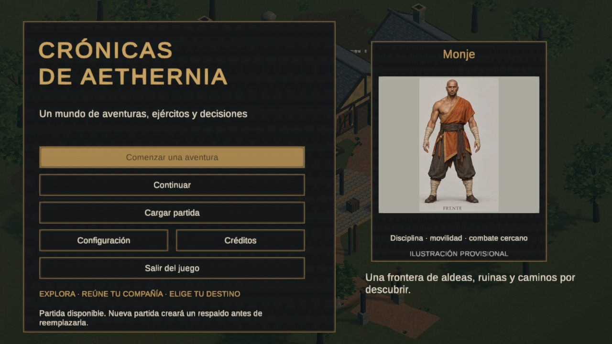
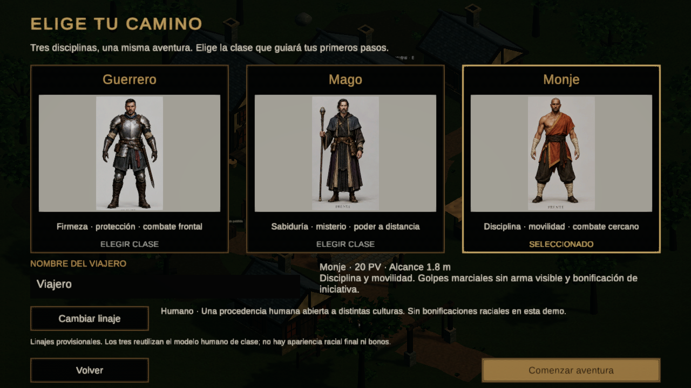

# E16 — comparación visual

Capturas reales de Unity o de la build Windows. Sin retoques ni imágenes IA usadas como evidencia. El estado de partida, cámara y encuadre pueden diferir: comparación cualitativa, no una prueba de rendimiento o equivalencia píxel a píxel. Origen, resolución y SHA de cada PNG en `Docs/Validacion/E16/CAPTURAS.json`.

| Vista | Antes | E16 |
| --- | --- | --- |
| Menú | [Abrir](Antes/Menu.png) | [Abrir](Demo/warrior-Main.png) |
| Selección | [Abrir](Antes/Seleccion.png) | [Monje](PlayMode/Class-monk-1280.png), [Guerrero](PlayMode/Class-warrior-1280.png), [Mago](PlayMode/Class-mage-1280.png) |
| Ruinas | [Abrir](Antes/Ruinas.png) | [Interior](Expedition/warrior-Interior.png), [grupo](Expedition/monk-GroupCombat.png) |
| RTS | [Abrir](Antes/RTS.png) | [Patrulla](Demo/warrior-Rts.png), [conquista](Expedition/warrior-RtsBattle.png) |

Menú E16:

Selección E16:

Más vistas: `PlayMode/` contiene las tres resoluciones; `Demo/` y `Expedition/`, recorridos del player con acciones y guardados reales. Las ilustraciones de las tarjetas son arte temporal ya existente; no representan la calidad final del modelo 3D.
