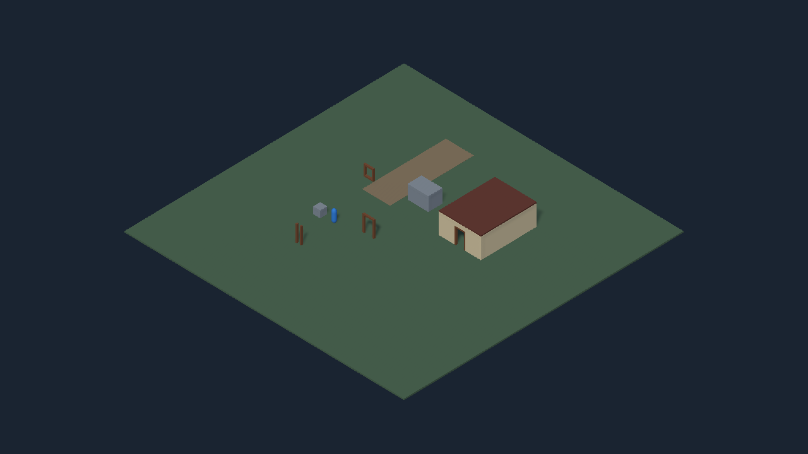

# Validación de la base técnica

Fecha: 2026-10-28, America/La_Paz. Editor: Unity 6000.5.8f1. Ejecuciones locales en segundo plano; no se automatizó la ventana.

## BAS-01 Entorno

Resultado: 3 de 3 pruebas aprobadas, sin omisiones y con código de salida 0. XML: `ProyectoRPGRTS/Logs/Baseline-results.xml`. Ejecución de las pruebas: 2026-10-28 17:49:37–17:49:38 UTC (13:49:37–13:49:38 en Bolivia); la importación y el arranque del editor son adicionales a esa duración.

| Prueba | Resultado |
| --- | --- |
| Editor exacto, paquetes registrados con las versiones del manifest y URP configurado | Aprobada |
| SampleScene sin scripts ni referencias serializadas perdidos | Aprobada |
| Cargar SampleScene, entrar a Play Mode, ejecutar y volver a Edit Mode | Aprobada |

La configuración inicial de pruebas necesitó corregir referencias duplicadas del asmdef, resolver PackageInfo explícitamente y usar EntityId en lugar de una API obsoleta de Unity 6.5. El resultado anterior corresponde a la ejecución posterior a esas correcciones.

## BAS-02 y BAS-03 Escala y escena técnica

Generación completada con código 0 mediante APIs del editor: seis prefabs métricos y siete materiales URP en carpetas nuevas, más `Assets/01_Scenes/TechnicalSandbox.unity`. La herramienta rechaza salidas existentes y no sobrescribe SampleScene. Geometría de ensayo con suelo de 40 × 40 m, obstáculo, puerta, paso estrecho, casa y referencias de tamaño.

Resultado final: 12/12 pruebas aprobadas, sin fallos ni omisiones, código de salida 0. XML local: `ProyectoRPGRTS/Logs/Foundation-results.xml`. Ejecución de pruebas: 2026-10-28 19:24:31–19:24:41 UTC (15:24:31–15:24:41 en Bolivia); duración del conjunto 9,71 s, sin contar arranque/importación.

| Comprobación | Casos | Resultado |
| --- | --- | --- |
| Regresión del entorno original, paquetes y Play Mode | 3 | Aprobados |
| Dimensiones importadas de cubo, humano, puerta, ventana, casa y suelo | 6 | Aprobados |
| Cápsula con altura/diámetro correctos, paso por puerta/casa y bloqueo en hueco estrecho | 1 | Aprobado |
| Referencias, materiales URP soportados y suelo en Y=0 | 1 | Aprobado |
| Play Mode, captura GPU no vacía y retorno a Edit Mode | 1 | Aprobado |

La primera ejecución del conjunto obtuvo 11/12: el reinicio de SetUp después de EnterPlayMode intentaba usar una API de edición de escenas mientras el juego estaba activo. Se corrigió la preparación de la prueba para conservar la escena durante Play Mode y se repitió el conjunto completo; el resultado final es el de la tabla.

Revisión visual completada sobre la captura GPU 1280×720: suelo completo, casa, huecos, humano y cubo visibles, colores/materiales URP correctos y sombras legibles; no se observan materiales rosas, imagen vacía ni recortes del terreno. Es una revisión de geometría técnica, no de arte final.



La comparación Git confirma que SampleScene y su `.meta`, el GDD, los paquetes y los ajustes preexistentes conservan su contenido. SHA-256 del Word: `dba82b1c18eb51bd36ee353cd3380af108aea41fe7ec539da644f08ea76bb661`. Unity añadió `ProjectSettings/SceneTemplateSettings.json` al crear la nueva escena; se conserva con los demás cambios.

La cámara de inspección es fija. Esta entrega no valida todavía controles isométricos, selección, movimiento, navegación horneada, interacción ni UI. Tampoco es una build jugable: la build de integración corresponde a BAS-09.

## Repetir las comprobaciones

Con el proyecto cerrado en Unity, desde la raíz de trabajo:

```powershell
.\Tools\Invoke-UnityValidation.ps1 -Mode Baseline
.\Tools\Invoke-UnityValidation.ps1 -Mode Foundation
```

`Baseline` se ejecuta sin dispositivo gráfico; `Foundation` usa renderizado en batch para la captura. El XML y los registros se guardan en `ProyectoRPGRTS/Logs/`, fuera de Git. El lanzador exige un XML nuevo, al menos una prueba ejecutada, resultado Passed y proceso con código 0.

La creación inicial se realizó con `-Mode GenerateSandbox`. No repetir ese modo sobre los assets existentes; conservar y editar los prefabs/escena desde sus fuentes. No se necesita instalar plugins ni cambiar paquetes.

Referencias técnicas: [pruebas de Unity por comandos](https://docs.unity.com/en-us/engine/6000.5/manual/scripting/test-framework-introduction/running-tests/run-tests-from-command-line) y [migración a EntityId](https://docs.unity.com/en-us/engine/6000.5/manual/scripting/fundamental-unity-types/instanceid-to-entityid-migration). Los resultados descritos proceden de las ejecuciones locales.
