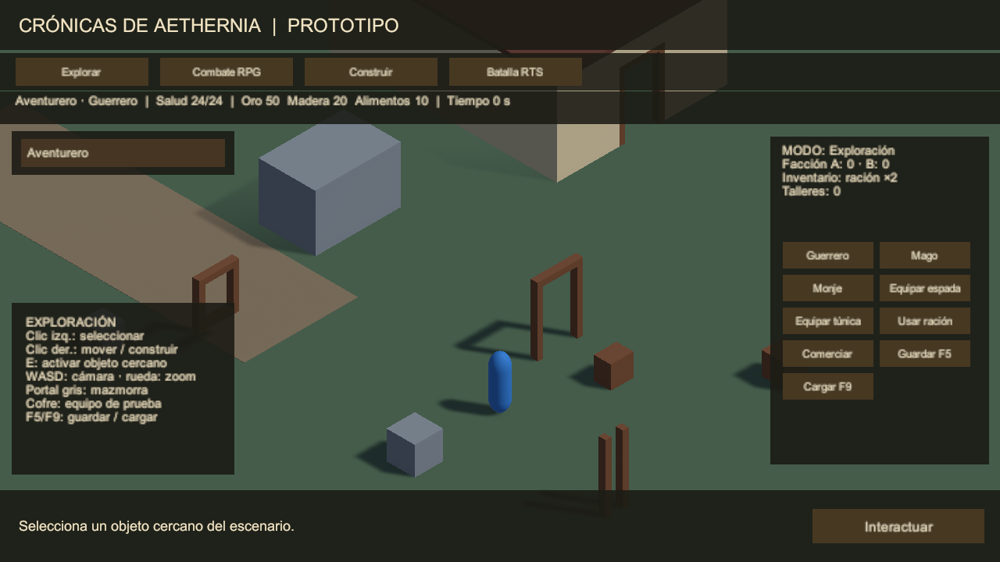
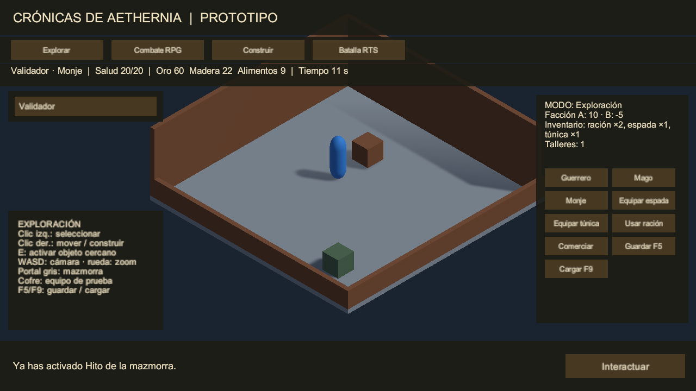
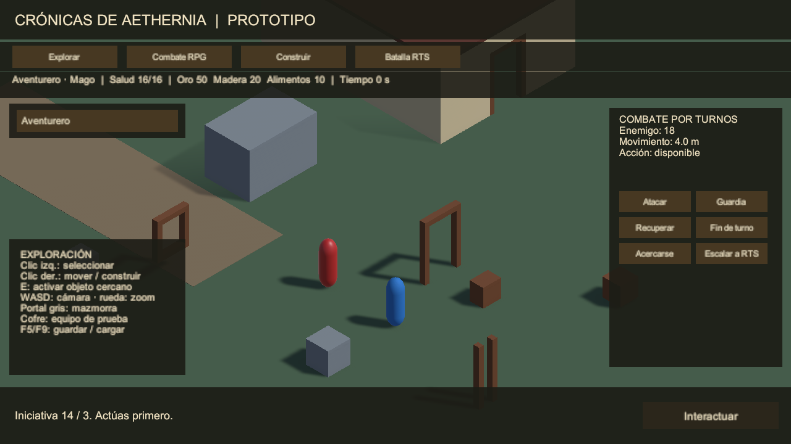
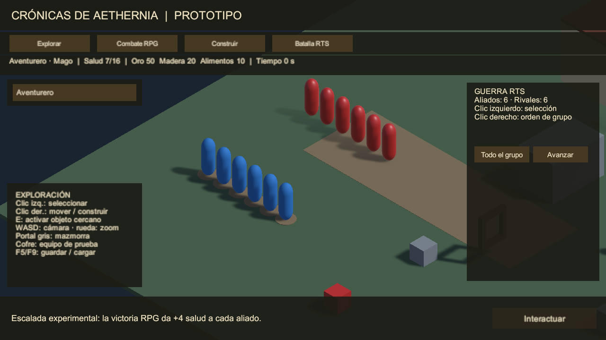

# Validación del prototipo jugable

Informe histórico de la primera etapa (2026-10-29). La auditoría posterior, evidencia vigente y pendientes humanos se registran en `AUDITORIA_FASE_2.md`; las 23 pruebas y métricas de este documento describen la entrega anterior. La carpeta Windows se actualiza al recompilar; el ZIP original conserva aquella entrega.

Fecha de seguimiento: 2026-10-29, America/La_Paz. Editor exacto: Unity 6000.5.8f1; URP 17.5.0. Alcance aprobado en ESPECIFICACION_PROTOTIPO.md: prototipo técnico con reglas ajustables, sin producción comercial ni contenido narrativo definitivo.

## Resultado de pruebas

Suite final de editor/Play Mode: **23/23 aprobadas, cero fallos y cero omisiones, salida 0**. El XML y el log están en `ProyectoRPGRTS/Logs/Vertical-results.xml` y `Vertical.log`. La ejecución de las pruebas duró 7,34 segundos; ese dato excluye arranque, importación y compilación de Unity y no es una métrica de rendimiento de la versión comercial.

| Grupo | Casos | Evidencia |
| --- | --- | --- |
| Entorno original | 3 | Editor/paquetes exactos; SampleScene sin referencias perdidas; entrada y salida de Play Mode |
| Referencias métricas | 9 | Seis prefabs medidos, paso de cápsula, hueco incompatible, suelo, materiales URP y render |
| Base jugable | 3 | Cámara con límites, selección, UI bloqueando órdenes, ruta alrededor de obstáculo, interacción única, HUD y dos resoluciones |
| Reglas y persistencia | 5 | Capacidad/equipo/consumo, costes/producción, turnos/movimiento, iniciativa sin impacto garantizado y rechazo de datos corruptos/incompatibles |
| Integración vertical | 3 | Escena final sin referencias perdidas; clases, talleres, carving, mazmorra y guardado compartido; victoria RPG, escalada y resultado RTS persistente |

La prueba integrada selecciona las tres clases y verifica salud/velocidad, recoge/equipa objetos, comercia, construye, rechaza solapamientos sin cobrar, comprueba que el taller talle la navegación, produce consumiendo alimento, guarda/carga recursos y equipo, viaja a la mazmorra y conserva reputación/consecuencias. La carga corrupta se rechaza sin alterar el estado actual.

La prueba RPG controla una semilla y comprueba iniciativa, acciones, alcance y resultado. La transición experimental aporta +4 de salud a cada aliado RTS, inicia seis unidades contra seis, concluye con victoria y mantiene pausado el calendario compartido. La evaluación subjetiva de diversión y balance no se ha realizado automáticamente: figura en la hoja de ruta humana aprobada.

## Revisión visual

Se revisaron capturas nativas del motor con GPU en batch, sin controlar la ventana: exploración/HUD en 1280×720 y 1920×1080, mazmorra, combate RPG y batalla RTS. Se comprobaron lectura, disposición, materiales, sombras y objetos visibles. Los muros delanteros de la mazmorra se redujeron a parapetos para revelar la salida sin cambiar su huella ni permitir atravesarlos con el agente.

## Build y ejecución independiente

La primera build de la base jugable compiló y arrancó con salida 0, completando movimiento e interacción sin editor. La build definitiva también compiló y completó el recorrido integrado en un proceso independiente sin ventana, con salida 0: exploración, equipo, comercio, taller, mazmorra, consecuencia de facciones, guardado/carga, victoria RPG, escalada, orden de grupo RTS, victoria territorial y guardado final.

Ejecutable: `ProyectoRPGRTS/Builds/Windows/Aethernia.exe`. Comprobante: `ProyectoRPGRTS/Logs/Final-build-smoke.txt`, generado por `Tools/Invoke-PrototypeSmoke.ps1` con fecha nueva y salida 0. Tamaño informado por Unity: 170.913.663 bytes; compilación incremental final: 37,42 s.

El estado guardado por el player confirma clase Mago, un taller y los cuatro hechos `reference-chest`, `dungeon-objective`, `rpg-victory` y `rts-victory`. El recorrido del ejecutable final terminó en 7,40 s, 36.785 iteraciones de frame en modo sin gráficos y 102.014.841 bytes asignados al tomar la muestra. Son datos de automatización y una instantánea de memoria, no FPS ni memoria máxima de una partida con renderizado.

Paquete portable: `ProyectoRPGRTS/Builds/Aethernia-Prototipo-Windows.zip`, 71.065.469 bytes. Incluye ejecutable y dependencias runtime, con LEEME.txt; excluye la carpeta de símbolos Burst marcada DoNotShip. SHA-256: `941B53550F5FD55E58ADA307B0DB01610E293176D1F6EC7B794EE24D64FD15D4`.

## Mediciones y límites

El tramo RTS de la suite final concluyó en 5,95 s reales, con 9.389 iteraciones de frame en batch y 641.246.944 bytes asignados por el editor al tomar la muestra. Es una medición de ese proceso de prueba, no FPS de juego con pantalla ni requisito mínimo comercial. No se han extrapolado esos números a ejércitos grandes.

La build definitiva registró también duración, frames y memoria asignada del player en su comprobante. Los presupuestos comerciales de plataformas y contenido permanecen abiertos según la hoja de ruta aprobada.

El GDD original conserva SHA-256 `dba82b1c18eb51bd36ee353cd3380af108aea41fe7ec539da644f08ea76bb661`. SampleScene y TechnicalSandbox se preservan. NavMeshAreas y EditorBuildSettings se actualizaron deliberadamente para el agente métrico y la escena de arranque. Unity reserializó ajustes de render/volumen y batching al construir; se revisa y conserva ese diff sin actualizar paquetes.

Para repetir: ejecutar `Invoke-UnityValidation.ps1 -Mode Vertical`, luego `-Mode Build` y finalmente `Invoke-PrototypeSmoke.ps1`, con el editor cerrado sobre este proyecto. Las pruebas usan sus propios archivos en Logs y no sobrescriben la partida guardada del jugador.
